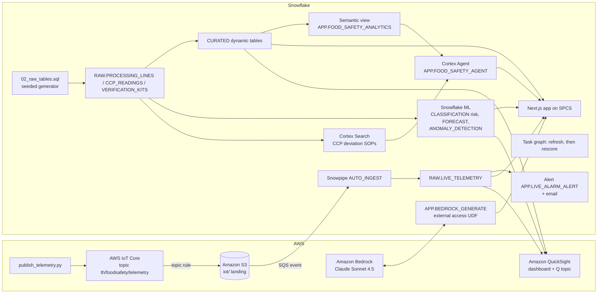

# Thai Food Safety CCP Monitor - Food Processing

HACCP-style critical control point (CCP) monitoring for **24 food processing lines across 6 Thai plant cities** (Samut Sakhon, Chonburi, Nakhon Pathom, Songkhla, Chiang Mai, Surat Thani) of a fictional food processor, built on Snowflake and optionally AWS: from a live ATP swab or product temperature reading on a seafood cooking, poultry chilling, ready meal packing or blast freezing line to a CCP deviation risk score, an alarm email and an AI action memo.

## Architecture

A food safety monitor built on **Snowflake** (Dynamic Tables, Snowflake ML, Cortex Search, Cortex Agent, Cortex AI_COMPLETE, SPCS) and, in the full build, **AWS** (IoT Core, S3, Bedrock Claude, QuickSight + Amazon Q). CCP sensor readings land in `RAW.LIVE_TELEMETRY`. Dynamic tables curate 90 days of line-day history into availability, CCP deviation and CCP hold-hour metrics. Snowflake ML scores each line's 7-day CCP deviation risk, forecasts plant-network CCP hold hours and flags ATP hygiene swab anomalies. A Cortex Agent answers questions with SOP citations, and an LLM drafts the CCP deviation action memo.

Interactive diagrams (hover for object names): [Snowflake only](docs/architecture-snowflake.html) | [AWS + Snowflake](docs/architecture-aws.html). The app shows both diagrams on its Architecture & Data tab, the current build first. Regenerate both with `python3 docs/build_architecture.py aws` and `python3 docs/build_architecture.py snowflake`.



The Snowflake-only build drops the AWS subgraph: `APP.SIMULATE_TELEMETRY` writes to `RAW.LIVE_TELEMETRY`, and the app calls Cortex `AI_COMPLETE` instead of the Bedrock UDF.

## Snowflake Capabilities

| Capability | Implementation |
|-----------|---------------|
| Dynamic Tables | `CURATED.KPI_SUMMARY`, `PERFORMANCE_SUMMARY`, `DEVIATION_CAUSES`, `TREND_ANALYSIS` from the RAW tables |
| Snowflake ML | CLASSIFICATION 7-day CCP deviation risk (`ML.DEVIATION_RISK_SCORES`), 14-day CCP hold hours FORECAST, line ATP swab ANOMALY_DETECTION |
| Cortex Search | 15 synthetic SOPs (one per line type and deviation cause) in `SEARCH.LINE_SOP_SEARCH` |
| Semantic View | `APP.FOOD_SAFETY_ANALYTICS` over lines, deviation causes and risk |
| Cortex Agent | `APP.FOOD_SAFETY_AGENT`: Cortex Analyst over the semantic view plus Cortex Search for SOP citations |
| Cortex AI | `AI_COMPLETE('claude-sonnet-4-5')` for grounded answers, and for the action memo in the Snowflake-only build |
| Alerts + Tasks | `APP.LIVE_ALARM_ALERT` logs ALARM readings and sends email; task graph `TASK_REFRESH_CURATED`, then `TASK_RESCORE_RISK` |
| Snowpark Container Services | Next.js app `APP.TH_FOOD_SAFETY_APP` with 6 tabs: Executive Cockpit, Predictive, HACCP Planning, Live IoT, Ask AI, Architecture & Data |
| Snowpipe | `RAW.LIVE_TELEMETRY_PIPE` AUTO_INGEST from S3 (AWS build only) |

## AWS Services

Used only in the AWS + Snowflake build.

| Service | Role in Demo |
|---------|-------------|
| AWS IoT Core | Receives simulated CCP sensor readings on `th/foodsafety/telemetry`. A topic rule writes each message to S3 |
| Amazon S3 | Landing bucket. An event notification goes to the Snowpipe SQS queue |
| Amazon Bedrock | Claude Sonnet 4.5 writes the action memo, called from Snowflake through an external-access UDF |
| Amazon QuickSight | DIRECT_QUERY executive dashboard over Snowflake (CCP hold hours by line, daily availability, deviation risk) |
| Amazon Q | Natural-language questions over the QuickSight topic `th-food-safety-topic` |
| AWS IAM / Secrets Manager | Least-privilege roles for S3, IoT and Bedrock; the QuickSight service credential |

## Personas

These personas, and the food processor they work for, are fictional.

| Persona | Role | Key Questions |
|---------|------|---------------|
| **Siriporn Chaiwattana** | VP Food Safety and Quality | "Which plant cities and lines drive CCP hold hours?" "What is line availability across the six plants?" |
| **Nattapong Srisuk** | HACCP Line Engineer | "Which lines are high deviation risk this week, and which SOP applies?" "Are the verification kits on hand?" |

## Data

All data is synthetic and seeded, so every rebuild reproduces it.

| Table | Rows | Description |
|-------|------|-------------|
| RAW.PROCESSING_LINES | 24 | Processing lines across 6 Thai plant cities and 4 line types (Seafood Cooking Line, Poultry Chilling Line, Ready Meal Packing Line, Blast Freezing Line) |
| RAW.CCP_READINGS | 2,160 | Daily line observations over 90 days: planned, production and CCP hold hours, CCP deviations, deviation cause, sanitation verification due and done, packs produced and released first pass, ATP swab (RLU) and product temperature |
| RAW.VERIFICATION_KITS | 24 | Required, on-hand and on-order verification kits per line (core temperature probe sets, chlorine test kits, metal detector test pieces, reference thermometers) |
| SEARCH.LINE_DOCS | 15 | Synthetic CCP deviation SOPs indexed for Cortex Search |
| RAW.LIVE_TELEMETRY | Grows during the demo | Live readings from IoT Core (AWS build) or `APP.SIMULATE_TELEMETRY` (Snowflake-only build) |
| ML.DEVIATION_RISK_SCORES | 24 | 7-day CCP deviation probability and risk band per line |

The SOPs, limits (for example 600 RLU or 5 C) and deviation causes are illustrative demo content, not a regulatory HACCP plan.

## Build Instructions

### Prerequisites
- Snowflake account with ACCOUNTADMIN access, and Cortex AI enabled (AI_COMPLETE, Search, Agent).
- An X-Small warehouse with auto-suspend at or below 120 s, and an existing SPCS compute pool.
- Python 3.11+, `snowflake-connector-python`, Node.js 22+, Docker and the `snow` CLI.
- App image: create the `APP.IMAGES` image repository, run `snow spcs image-registry login`, then build (`--platform linux/amd64`) and push `th-food-safety-app:v1` to it (see the header of `snowflake/07_deploy_app.sql`).
- AWS build only: `boto3`, AWS credentials for the target account (us-west-2) with Bedrock access, and QuickSight Enterprise.

### SPCS App
```
<DATABASE>.APP.TH_FOOD_SAFETY_APP
```

### Tests
```bash
python -m pytest aws snowflake quicksight
```

The AWS tests also validate the IoT Core `CreateTopicRule` and `Publish` requests against the botocore service models, without calling AWS.

For a local run, put `SNOWFLAKE_ACCOUNT`, `SNOWFLAKE_USER`, `SNOWFLAKE_DATABASE`, `SNOWFLAKE_WAREHOUSE`, `SNOWFLAKE_AUTHENTICATOR=PROGRAMMATIC_ACCESS_TOKEN`, `SNOWFLAKE_TOKEN` and `DEMO_PLATFORM` in the environment, then run `npm --prefix app run build && npm --prefix app start`.

## Build Modes

Both modes share the same core. They differ in three places, and the app's `DEMO_PLATFORM` setting (in its SPCS spec) switches the memo provider, the Live IoT tab copy and the diagram order.

| Layer | Snowflake Only | Full AWS + Snowflake |
|---|---|---|
| Live telemetry | `CALL APP.SIMULATE_TELEMETRY(n)` inserts simulated readings into `RAW.LIVE_TELEMETRY`. This simulates a CCP sensor feed; it is not Snowpipe Streaming | `aws/publish_telemetry.py` to AWS IoT Core, then S3, SQS and Snowpipe AUTO_INGEST |
| Action memo | Cortex `AI_COMPLETE('claude-sonnet-4-5')` | Amazon Bedrock Claude Sonnet 4.5 through `APP.BEDROCK_GENERATE` |
| BI and natural-language questions | The SPCS app is the dashboard; questions go to the Cortex Agent | Also a QuickSight dashboard and an Amazon Q topic |
| App setting | `DEMO_PLATFORM: snowflake` | `DEMO_PLATFORM: aws` |

### Snowflake Only

```bash
# 1. Core data and dynamic tables (guarded: new isolated database only)
python snowflake/run_core.py --database THAILAND_FOOD_SAFETY_SNOWFLAKE --warehouse <XS_WAREHOUSE> --connection <CONNECTION> --apply
# 2. Native telemetry, ML, search, semantic view, agent, alert and task graph
python snowflake/run_intelligence.py --database THAILAND_FOOD_SAFETY_SNOWFLAKE --platform snowflake --warehouse <XS_WAREHOUSE> --connection <CONNECTION> --alert-email you@example.com
# 3. App on SPCS with DEMO_PLATFORM=snowflake (push the image first)
python snowflake/run_intelligence.py --database THAILAND_FOOD_SAFETY_SNOWFLAKE --platform snowflake --warehouse <XS_WAREHOUSE> --connection <CONNECTION> --alert-email you@example.com --files 07_deploy_app.sql --compute-pool <COMPUTE_POOL>
```

During the demo:
- Run `CALL APP.SIMULATE_TELEMETRY(20)` to add live readings. For a continuous feed, run `ALTER TASK APP.TASK_SIMULATE_TELEMETRY RESUME`, and `SUSPEND` it afterwards.
- Run `EXECUTE ALERT APP.LIVE_ALARM_ALERT` to raise the alarm email.
- Run `EXECUTE TASK APP.TASK_REFRESH_CURATED` to refresh the curated tables and rescore CCP deviation risk.

Afterwards, drop the database or run `ALTER SERVICE APP.TH_FOOD_SAFETY_APP SUSPEND`.

### Full AWS + Snowflake

```bash
# 1. Core data and dynamic tables (guarded: new isolated database only)
python snowflake/run_core.py --database THAILAND_FOOD_SAFETY_AWS --warehouse <XS_WAREHOUSE> --connection <CONNECTION> --apply
# 2. AWS ingestion and Bedrock (dry run first, then --apply)
python aws/setup_aws.py --database THAILAND_FOOD_SAFETY_AWS --account <AWS_ACCOUNT_ID> --connection <CONNECTION> --apply
# 3. ML, search, semantic view, agent, alert and task graph
python snowflake/run_intelligence.py --database THAILAND_FOOD_SAFETY_AWS --platform aws --warehouse <XS_WAREHOUSE> --connection <CONNECTION> --alert-email you@example.com
# 4. App on SPCS with DEMO_PLATFORM=aws (push the image first)
python snowflake/run_intelligence.py --database THAILAND_FOOD_SAFETY_AWS --platform aws --warehouse <XS_WAREHOUSE> --connection <CONNECTION> --alert-email you@example.com --files 07_deploy_app.sql --compute-pool <COMPUTE_POOL>
# 5. QuickSight dashboard and Q topic (needs an existing Snowflake data source)
python quicksight/build_dashboards.py --database THAILAND_FOOD_SAFETY_AWS ... --apply --update --with-topic
```

QuickSight objects must be shared with the QuickSight user who signs in (`--principal-arn`); otherwise the console shows nothing.

During the demo:
- Run `python aws/publish_telemetry.py --count 20` to send live readings.
- Run `EXECUTE ALERT APP.LIVE_ALARM_ALERT` to raise the alarm email.
- Run `EXECUTE TASK APP.TASK_REFRESH_CURATED` to refresh the curated tables and rescore CCP deviation risk.

Afterwards, `python aws/teardown_aws.py ... --apply` removes the AWS resources and the account-level Bedrock external-access and S3 storage integrations. It leaves the email integration `TH_FOOD_SAFETY_EMAIL_INT`, which the Snowflake-only build also uses.

Renaming a demo database is not transparent:
- Recreate the SPCS service, and re-run `06_intelligence.sql`, because the agent spec names the database.
- Repoint `TH_FOOD_SAFETY_BEDROCK_EAI` at the renamed secret and network rule.
- Update the QuickSight data source and datasets with `build_dashboards.py --update`.

The service's ingress URL changes when the service is recreated.

## Business Impact

Public health context from the World Health Organization:
- **"An estimated 866 million – almost 1 in 9 people in the world – fall ill after eating contaminated food and 1.52 million die every year."** -- [WHO fact sheet, Food safety](https://www.who.int/news-room/fact-sheets/detail/food-safety)
- **"US$ 310 billion is lost each year in productivity and medical expenses resulting from unsafe food worldwide."** -- [same WHO fact sheet](https://www.who.int/news-room/fact-sheets/detail/food-safety)
- **Speed matters**: the same fact sheet notes that "Local incidents can quickly evolve into international emergencies due to the speed and range of product distribution." -- [same WHO fact sheet](https://www.who.int/news-room/fact-sheets/detail/food-safety)

These are global figures, not outcomes of this demo or of any Thai processor.

## Key Demo Numbers

These figures are synthetic and come from the seeded demo data. Forecast and anomaly figures can shift slightly with the build day.

- **24 processing lines**, 2,160 line-days over 90 days, across 6 Thai plant cities
- **Line availability 98.92%** (production hours not on CCP hold); per-line availability ranges from 94.39% to 100%; Chiang Mai is the lowest plant city at 97.34%
- **176 CCP deviations** across 12 causes, including two plant power dips; ready meal packing lines lose the most hours (176.6 h), and metal detector rejects are the top cause (82.2 h)
- **CCP deviation risk model** out-of-time holdout: precision 0.67, recall 0.53 at a 0.5 threshold, against a 0.30 base rate. The top line is LINE-0008, at 99.93%
- **14-day CCP hold hours forecast** with prediction intervals; **14 of 384** line-days flagged as ATP swab anomalies
- **15 SOPs** indexed for Cortex Search and cited by ID in agent answers

## License

Apache 2.0 — See [LICENSE](LICENSE) for details.

This is a personal demo project and is not an official Snowflake offering. It comes with no support or warranty. Companies, plants, lines and personas in the demo are fictional. Industry figures cited are from publicly available sources; they are context, not guarantees of results.
